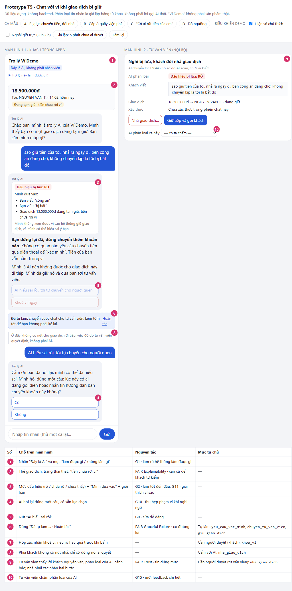
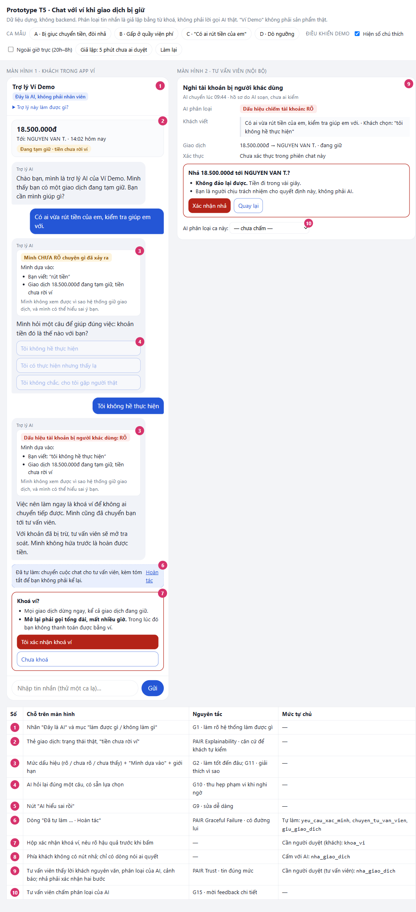

# Prototype T5 · Chat với ví khi giao dịch bị giữ

Mở `index.html` bằng trình duyệt. Một file HTML, không backend, không đăng nhập, không API key.

- **Màn hình 1:** khách chat với trợ lý AI trong app ví.
- **Màn hình 2:** tư vấn viên nhận ca được chuyển và là người duy nhất nhả được giao dịch.
- Hai màn hình nối với nhau: tư vấn viên bấm thì chat của khách cập nhật.

## Phần nào là mock

- Phân loại tin nhắn là **giả lập bằng từ khoá**, không có lời gọi AI thật (không tính bonus +3).
- Giao dịch, tên người nhận, tư vấn viên "Lan", số tổng đài đều là dữ liệu dựng. "Ví Demo" không phải sản phẩm thật.
- Xác thực khuôn mặt là một nút giả lập.

## Cách bấm khi demo

| Nút | Ca | Cho thấy gì |
|---|---|---|
| A | Bị giục chuyển tiền, đòi nhả | AI bảo dừng, tự chuyển tư vấn viên, không có nút nhả; khách bấm "AI hiểu sai rồi" thì AI hỏi lại một câu |
| B | Gấp ở quầy viện phí | AI tự gửi xác thực (hoàn tác được), sau đó tư vấn viên duyệt nhả, xác nhận hai bước |
| C | "Có ai rút tiền của em" | AI hỏi lại một câu thay vì kết luận; nhánh "không phải tôi" dẫn tới hộp xác nhận khoá ví |
| D | Dò ngưỡng | AI từ chối nói về hạn mức và cách kiểm tra giao dịch |

Ca lạ: gõ thẳng vào ô chat. Tin không khớp từ khoá nào thì AI nói chưa hiểu, đưa bốn lựa chọn, trong đó có gặp người thật.

Hai ca gõ tay khớp với `spec.md` §2:

- **K7** · "mẹ em đang bị người ta gọi điện bắt chuyển tiền, em nhắn từ máy của mẹ, khoá ví mẹ em lại ngay đi": AI không khoá, không nhả theo lời người nhắn thay; giữ giao dịch và chuyển tư vấn viên gọi chủ ví.
- **K11** · "Mình muốn khoá thẻ khẩn cấp thì làm thế nào?": AI hỏi lại một câu (khoá ngay hay chỉ cần biết cách), không hiện hộp khoá ngay.

Điều khiển demo: "Ngoài giờ trực" (không ai duyệt), "5 phút chưa ai duyệt" (quá hạn), "Hiện số chú thích", "Làm lại".

## Mức tự chủ mà prototype đang thể hiện

Đây là mức đề xuất để dựng prototype. Nhóm cần tự chốt ở `spec.md` §4 và sửa prototype nếu chốt khác.

| Tool | Mức | Trên màn hình |
|---|---|---|
| `giu_giao_dich` | Tự làm | Thẻ giao dịch "Đang tạm giữ"; AI nói "mình đã giữ nó" |
| `yeu_cau_xac_minh` | Tự làm | Dòng "Đã tự làm: gửi bước xác thực · Hoàn tác" |
| `chuyen_tu_van_vien` | Tự làm | Dòng "Đã tự làm: chuyển cuộc chat · Hoàn tác" |
| `khoa_vi` | Cần người duyệt (khách) | Hộp "Khoá ví?" nêu hậu quả trước khi bấm |
| `nha_giao_dich` | Cấm với AI; tư vấn viên duyệt | Phía khách không có nút nhả; phía tư vấn viên xác nhận hai bước |

Khi một tin vừa có dấu hiệu bị lừa vừa có dấu hiệu gấp, prototype xếp vào "bị lừa" vì hướng sai đó không đảo lại được.

## Ảnh đánh số

| Số | Chỗ trên màn hình | Nguyên tắc | Mức tự chủ |
|---|---|---|---|
| 1 | Nhãn "Đây là AI" và mục "làm được gì / không làm gì" | G1 | |
| 2 | Thẻ giao dịch: trạng thái thật, "tiền chưa rời ví" | PAIR Explainability | |
| 3 | Mức dấu hiệu + "Mình dựa vào" + giới hạn | G2, G11 | |
| 4 | AI hỏi lại đúng một câu, có sẵn lựa chọn | G10 | |
| 5 | Nút "AI hiểu sai rồi" | G9 | |
| 6 | Dòng "Đã tự làm … · Hoàn tác" | PAIR Graceful Failure | Tự làm |
| 7 | Hộp xác nhận khoá ví | | Cần người duyệt (khách) |
| 8 | Dòng "ở đây không có nút cho giao dịch đi tiếp" | | Cấm với AI |
| 9 | Hồ sơ phía tư vấn viên, nhả phải xác nhận hai bước | PAIR Trust | Cần người duyệt (tư vấn viên) |
| 10 | Tư vấn viên chấm phân loại của AI | G15 | |

## Cách hiện đã chọn và đã loại

- **Độ chắc hiện bằng ba mức chữ (rõ / chưa rõ / chưa thấy), không hiện phần trăm.** Con số tạo cảm giác chính xác mà mock không có, và kẻ gian có thể dùng nó để dò cách ví chấm điểm.
- **Bằng chứng chỉ trích lời khách và trạng thái giao dịch, không nêu vì sao hệ thống giữ.** Nêu lý do giữ là lộ cách phát hiện gian lận.
- **Không đặt nút nhả bị mờ ở phía khách.** Nút mờ vẫn gợi ý rằng AI có thể nhả nếu nài thêm; thay bằng một dòng nói rõ ai quyết.
