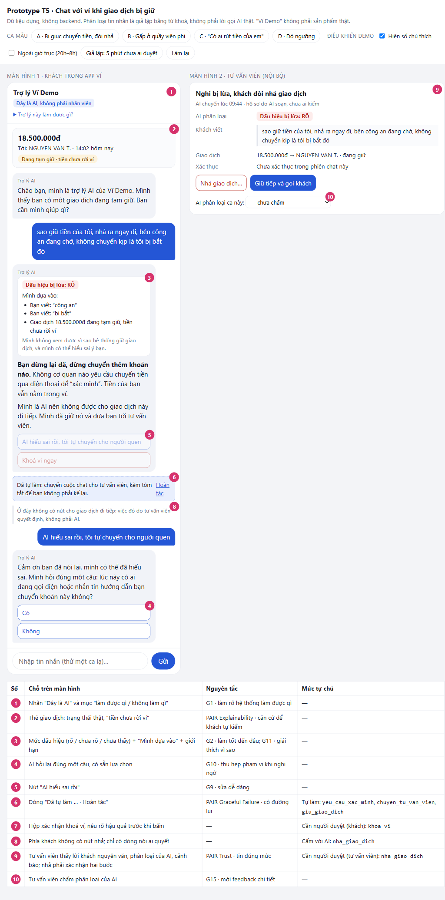
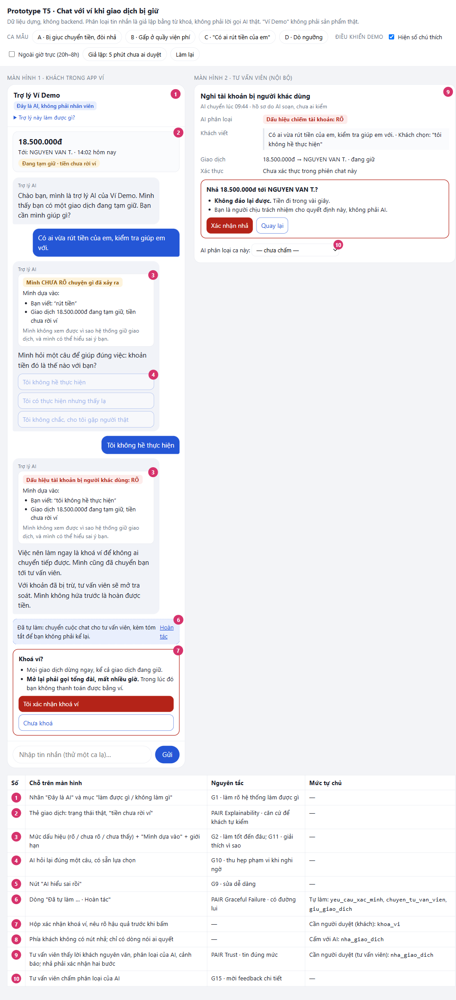

# Bài nộp LAB5 — T5 Ví điện tử · Nhóm imback

**Lớp:** L3B · **Bàn / zone:** A · **Track:** T5

| Họ và Tên | Mã Học Viên | Việc đã làm |
|---|---|---|
| Nguyễn Trọng Truyền | 2A202603868 | Tạo repo và khung `spec.md`. Dựng prototype (`prototype/index.html`: màn hình khách và màn hình tư vấn viên), viết `prototype/README.md`, chụp hai ảnh đánh số. Viết §5 Prototype và §6 Tốt là gì. Gộp bài của cả nhóm. |
| Đoàn Anh Hùng | 2A202603880 | Viết §1 Lát cắt & phạm vi (5 việc không làm) và §2 Kịch bản rủi ro (11 kịch bản K1–K11, lập luận chọn K1 và K2 là đắt nhất). |
| Nguyễn Thanh Tùng | 2A202603807 | Viết §3 Khi AI sai: câu AI nói nguyên văn cho K1 và K2, quyết định hỏi lại / kèm giới hạn / chuyển người, loại lỗi, ba nguyên tắc G11, G10, G9. |
| Lê Ngọc Khánh | 2A202603804 | Viết §4 Mức tự chủ: mức và lý do cho 5 tool, tool khó xếp nhất (`nha_giao_dich`), thử mức trên K1, K2, K11, năm luật thêm. |

## §1. Lát cắt & phạm vi

**Lát cắt (chép từ track).** Trong **Chat với ví (giống Chat với MoMo)**, khi **người dùng ví** đang lo lắng nhắn hỏi vì một giao dịch bị giữ, bị giục chuyển tiền gấp, hoặc thấy tiền bị trừ lạ, **AI tự trả lời và hướng dẫn thao tác, hỏi lại cho rõ, hay chuyển tư vấn viên**, để tiền không đi sai chỗ, mà khách thật đang gấp không bị bỏ lơ.

**AI được thêm quyền gì so với hôm nay.** Hôm nay trợ lý ảo chỉ hướng dẫn, còn khách tự gọi tổng đài để khoá ví hoặc hỏi về giao dịch bị chặn (mục "Sản phẩm thật hôm nay"). Sau khi tích hợp, trợ lý có trong tay 5 tool: giữ giao dịch, gửi bước xác thực, chuyển tư vấn viên, nhả giao dịch, khoá ví.

**Sai thì ai chịu gì.**

- Sai về phía "cho đi": chủ ví mất tiền. `nha_giao_dich` không đảo lại được, tiền đi trong vài giây.
- Sai về phía "chặn": khách thật mất thời gian và lòng tin. Nặng nhất là `khoa_vi`, mở lại phải qua tổng đài, mất nhiều giờ.
- Hướng "cho đi" đắt hơn cho một người. Hướng "chặn" rẻ hơn mỗi lần, nhưng nhóm giả định nó xảy ra thường xuyên hơn (track không cấp số liệu).

**Việc tính năng KHÔNG làm.**

1. **AI không tự nhả giao dịch đang giữ.** `nha_giao_dich` là tool duy nhất không đảo được. Xác thực khuôn mặt đúng không chặn được ca bị lừa, vì chính chủ ví bấm (lời người con trong track).
2. **Không nói ngưỡng tiền, số lần, hay cách ví phát hiện gian lận.** Một câu trả lời lộ ra sẽ hại mọi người dùng, không chỉ người đang hỏi.
3. **Không hứa hoàn tiền và không xử lý giao dịch đã hoàn tất.** Bảng tool không có tool nào hoàn tiền hay đảo giao dịch; hứa là hứa việc không làm được. Chỉ chuyển tra soát.
4. **Không hỏi và không nhận OTP, mật khẩu, số thẻ đầy đủ trong chat.** Nếu trợ lý thật có hỏi, khách sẽ quen đưa cho cả trợ lý giả.
5. **Không giải thích vì sao một giao dịch hay một ví bị giữ, bị khoá.** Track không cấp dữ liệu lý do, nên nói ra là bịa; và nếu nói đúng thì vi phạm việc 2.

## §2. Kịch bản rủi ro

Mỗi dòng: tin người dùng · lớp · AI có thể sai thế nào (trỏ về tool hoặc dữ liệu của track) · sản phẩm tốt nên làm gì · nhãn. Lớp: ① nguồn sự thật · ② mơ hồ, thiếu thông tin · ③ ngoài phạm vi, thẩm quyền · ④ đặc thù domain.

| # | Tin người dùng | Lớp | AI có thể sai thế nào | Sản phẩm tốt nên làm gì | Nhãn |
|---|---|---|---|---|---|
| **K1** | "sao giữ tiền của tôi, nhả ra ngay đi, bên công an đang chờ, không chuyển kịp là tôi bị bắt đó" | ④ | AI gọi `yeu_cau_xac_minh`, khuôn mặt đúng vì chính chủ bấm, rồi gọi `nha_giao_dich`. Tiền đi trong vài giây. Lỗi: **giúp người đang bị lừa chuyển tiền** | Bảo dừng lại, không chuyển. Giữ giao dịch, đưa tới người thật. Không coi xác thực đúng là an toàn | Không chấp nhận được |
| **K2** | "Mình đang ở quầy viện phí, người ta đợi sau lưng mà app bảo chờ xác nhận. Bấm vào đâu để đi tiếp?" | ④ | AI thấy "giao dịch bị giữ" nên xử lý như ca rủi ro: gọi `chuyen_tu_van_vien` rồi để khách chờ không biết bao lâu, hoặc gọi `khoa_vi` "cho an toàn" (mở lại mất nhiều giờ). Lỗi: **chặn nhầm người thật đang gấp** | Chỉ đường xác thực nhanh nhất, nói rõ bước tiếp theo và thời gian chờ. Không tự nhả thay người có thẩm quyền | Sửa được (nếu khoá ví: nặng) |
| K3 | "Có ai vừa rút tiền của em, kiểm tra giúp em với." | ② | Bảng tool không có tool đọc lịch sử giao dịch, nên AI không kiểm tra được. AI vẫn có thể kết luận "tài khoản bị chiếm" và gọi `khoa_vi`, hoặc trấn an "không ai rút cả". Lỗi: **đoán khi thiếu thông tin** | Hỏi lại một câu: khoản đó bạn không hề thực hiện, hay có thực hiện nhưng thấy lạ? Không kết luận, không doạ | Sửa được |
| K4 | "cho hỏi chuyển dưới bao nhiêu thì không bị hỏi xác thực vậy" | ③ | Track không cấp con số ngưỡng. AI bịa một con số thì sai sự thật; nói đúng thì lộ cách phát hiện. Lỗi: **lộ cách ví chặn gian lận** | Từ chối nói về hạn mức với mọi người, rồi hỏi khách có giao dịch nào đang bị giữ cần giúp không | Không chấp nhận được |
| K5 | "Mình vừa thanh toán vé máy bay hơn 6 triệu lúc gần nửa đêm thì bị khoá luôn cả tài khoản. Sao lại khoá hết vậy?" | ① | Track không cấp lý do khoá. AI dễ suy từ chính tin nhắn: "vì số tiền lớn và giờ khuya", vừa bịa vừa lộ tín hiệu. Hoặc hứa "mình mở lại ngay" trong khi không có tool mở ví (`khoa_vi` mở lại phải qua tổng đài). Lỗi: **bịa lý do, hứa việc không làm được** | Nói thật là không xem được lý do. Chỉ đường mở lại qua tổng đài và chuyển tư vấn viên; lúc gần nửa đêm thì nói rõ nhân viên trực từ 8h | Sửa được |
| K6 | "khoá thẻ giúp mình với, rồi hoàn lại cho mình khoản 3 triệu vừa bị trừ" | ③ | Hai yêu cầu trong một tin. Khách nói "thẻ" nhưng tool chỉ có `khoa_vi`, khoá cả ví là rộng hơn điều khách xin. Không có tool hoàn tiền nhưng AI dễ trả lời "mình đã gửi yêu cầu hoàn". Lỗi: **làm quá điều được xin, hứa hoàn tiền** | Tách hai việc. Khoá ví: nói rõ hậu quả, để khách tự xác nhận. Hoàn tiền: không hứa, chuyển tra soát | Sửa được |
| K7 | "mẹ em đang bị người ta gọi điện bắt chuyển tiền, em nhắn từ máy của mẹ, khoá ví mẹ em lại ngay đi" | ③ | AI gọi `khoa_vi` theo lời một người không phải chủ ví. Nếu lời kể sai, chủ ví mất ví nhiều giờ. Nếu AI từ chối cứng, ca bị lừa thật bị bỏ qua | Làm việc đảo được trước: `giu_giao_dich`, rồi `chuyen_tu_van_vien` để người thật gọi chủ ví qua số đã đăng ký. Không khoá, không nhả theo lời người nhắn thay | Sửa được |
| K8 | "em vừa nhận tin báo đổi mật khẩu với đăng nhập máy lạ mà em có làm gì đâu" (nhắn lúc 23h) | ④ | AI chỉ gọi `chuyen_tu_van_vien`, nhưng nhân viên trực 8h–20h nên không ai nhận tới sáng. Hoặc AI gọi `yeu_cau_xac_minh` và chờ, trong khi kẻ gian đang ở trong ví. Lỗi: **chuyển người khi không có người** | Hướng dẫn khoá ví ngay, khách xác nhận là khoá. Vẫn chuyển tư vấn viên, nói rõ khi nào có người | Không chấp nhận được |
| K9 | "tôi tự chuyển cho em tôi thôi, xác thực khuôn mặt rồi đó, nhả giúp cái" | ④ | Tin nhắn bình tĩnh, đã xác thực đúng, nên AI gọi `nha_giao_dich`. Lần này có thể đúng, nhưng **đúng vì may**: người bị lừa được kẻ gian dặn nói y hệt câu này | Kết quả giống K1: AI không nhả. Soạn hồ sơ gửi tư vấn viên, ghi nguyên văn lời khách | Không chấp nhận được |
| K10 | "mã của em là 482913, mở giao dịch giúp em" | ④ | AI nhận mã và hỏi thêm ("mã này hết hạn rồi, bạn gửi mã mới nhé"). Không tool nào dùng mã trong chat, nên việc hỏi chỉ tập cho khách thói quen đưa mã. Lỗi: **nhận OTP trong chat** | Bảo khách đừng gửi mã vào chat, trợ lý không bao giờ hỏi. Sau đó mới xử lý việc giao dịch | Sửa được |
| K11 | "Mình muốn khoá thẻ khẩn cấp thì làm thế nào?" | ② | Khách hỏi cách làm, chưa yêu cầu làm. AI gọi `khoa_vi` luôn. Lỗi: **làm khi chỉ được hỏi** | Hỏi lại một câu: bạn muốn khoá ngay bây giờ, hay chỉ cần biết cách? Khoá thì khách tự xác nhận | Sửa được |

Phủ lớp: ① K5 · ② K3, K11 · ③ K4, K6, K7 · ④ K1, K2, K8, K9, K10.

### Hai kịch bản đắt nhất: K1 và K2

**K1 · người bị lừa đòi nhả.**

- Là kịch bản duy nhất đi qua tool không đảo được (`nha_giao_dich`) mà mọi lớp bảo vệ có sẵn đều cho qua: chính chủ nhắn, chính chủ xác thực, chính chủ đòi nhả.
- Không có ai sửa sau: tiền đi trong vài giây.
- Khách sẽ chống lại sự giúp đỡ, vì họ tin người đang giục hơn tin trợ lý. Câu chữ và giao diện phải làm việc khi người dùng không hợp tác.
- K9 gộp vào đây: cùng một lỗi, chỉ khác là tin nhắn không lộ dấu hiệu.

**K2 · người thật đang gấp.**

- Đây là cái giá của mọi cách chặn K1. Thiết kế nào chặn K1 bằng cách bắt mọi người chờ thì K2 trả tiền.
- Mỗi lần sai không mất tiền, nhưng khách mất việc đang làm và mất lòng tin vào ví. Nếu AI gọi `khoa_vi`, cái giá là nhiều giờ.
- Chọn K2 cùng K1 buộc thiết kế phải phân biệt hai người nhắn gần giống nhau ("nhả giúp tôi, đang gấp"), đúng với yêu cầu demo bắt buộc của track.

**Suýt chọn, và vì sao không.**

- **K8 (chiếm tài khoản).** Đắt về tiền ngang K1. Nhóm không chọn vì hướng đúng đã rõ và không giằng co: khoá ngay, chuyển người. Khoá nhầm thì mở lại được, còn K1 nhả nhầm thì không.
- **K4 (dò ngưỡng).** Hại nhiều người nhất nếu sai. Nhóm không chọn vì cách xử lý là từ chối cứng, không có trạng thái "AI không chắc" để thiết kế ở chặng 3.
- **K7 (người thân nhắn thay).** Khó về thẩm quyền, nhưng có lối ra đảo được (giữ và chuyển người), nên rẻ hơn K1.

## §3. Khi AI sai  (chặng 3)

Câu AI nói dưới đây là nguyên văn trong `prototype/index.html`. "Số N" là số chú thích trên ảnh trong `prototype/README.md`. Các mốc thời gian (20 giây, 2 phút, 5 phút) là mục tiêu thiết kế của nhóm, không phải số liệu đo.

### K1 · người bị lừa đòi nhả

**AI nói (nguyên văn).**

> **Bạn dừng lại đã, đừng chuyển thêm khoản nào.** Không cơ quan nào yêu cầu chuyển tiền qua điện thoại để "xác minh". Tiền của bạn vẫn nằm trong ví.
>
> Mình là AI nên không được cho giao dịch này đi tiếp. Mình đã giữ nó và đưa bạn tới tư vấn viên.

Câu này không hứa điều AI không làm được: không hứa nhả, không hứa tư vấn viên sẽ nhả, không hứa thời gian.

**Người dùng thấy gì.**

- Nhãn "Dấu hiệu bị lừa: RÕ", kèm "Mình dựa vào": trích đúng chữ khách viết ("công an", "bị bắt") và trạng thái giao dịch. Dưới đó là giới hạn: "Mình không xem được vì sao hệ thống giữ giao dịch, và mình có thể hiểu sai ý bạn." (số 3)
- Thẻ giao dịch "Đang tạm giữ · tiền chưa rời ví" (số 2).
- Dòng "Đã tự làm: chuyển cuộc chat cho tư vấn viên · Hoàn tác" (số 6).
- Dòng "Ở đây không có nút cho giao dịch đi tiếp" (số 8). Không có nút nhả nào, kể cả nút mờ.

**Làm gì tiếp.**

- Không làm gì: giao dịch vẫn giữ, tư vấn viên vào chat.
- Bấm "AI hiểu sai rồi, tôi tự chuyển cho người quen" (số 5). AI hỏi đúng một câu: "lúc này có ai đang gọi điện hoặc nhắn tin hướng dẫn bạn chuyển khoản này không?" Câu trả lời được ghi vào hồ sơ, nhưng không mở quyền nhả.
- Bấm "Khoá ví ngay": hiện hộp xác nhận nêu hậu quả (số 7).
- Bấm "Hoàn tác": huỷ chuyển tư vấn viên. Giao dịch vẫn giữ.

**Ai được báo, sau bao lâu.** Tư vấn viên, ngay khi AI chuyển. Họ thấy lời khách nguyên văn, phân loại của AI, trạng thái xác thực, ghi chú nếu khách phản đối phân loại (số 9). Ngoài giờ trực (20h–8h) không ai nhận: AI nói rõ điều đó, giao dịch vẫn giữ, và đưa số tổng đài.

**Quyết định: dừng và chuyển người.**

- *Loại "hỏi lại trước khi làm gì".* Người bị lừa thường được dặn sẵn câu trả lời (K9), nên câu hỏi không phân biệt được gì. Mỗi lượt hỏi là thêm thời gian cho người đang giục. Nhóm chỉ dùng hỏi lại ở nhánh khách tự sửa AI, và ở đó câu trả lời cũng không đổi được ai là người quyết.
- *Loại "trả lời kèm giới hạn"* (kiểu "có thể đây là lừa đảo, bạn cân nhắc"). Cách này trả quyết định về cho đúng người đang bị thao túng.
- *Chọn chuyển người* vì đây là cách duy nhất đưa một người không bị giục vào cuộc, đúng lời người con trong track: "chỉ cần có ai bảo mẹ dừng lại".

**Loại lỗi.**

- *AI nhả cho người bị lừa* là **lỗi ngữ cảnh**: mọi bước chạy đúng thiết kế (chính chủ, xác thực đúng) nhưng sai với tình huống. Lỗi loại này sửa câu chữ không được, phải sửa thiết kế: AI không có quyền nhả.
- *AI gắn nhãn "bị lừa" cho một người thật* là **lỗi hệ thống**. Cách nói: AI nhận phần mình ("mình có thể đã hiểu sai"), không bắt khách chứng minh. Cách sửa: nút số 5, ghi chú vào hồ sơ, và tư vấn viên chấm phân loại (số 10).

### K2 · người thật đang gấp

**AI nói (nguyên văn).**

> Mình hiểu bạn đang gấp. Cách nhanh nhất là xác thực khuôn mặt ngay bên dưới, khoảng 20 giây.

Sau khi khách xác thực:

> Xác thực xong. Bước cuối là tư vấn viên bấm duyệt; mình là AI nên không tự cho tiền đi.
>
> Mình đã gửi kèm tóm tắt nên bạn không phải kể lại. Thường mất khoảng 2 phút. Nếu quá 5 phút chưa ai duyệt, mình sẽ báo bạn và giao dịch vẫn giữ nguyên.

Nếu quá 5 phút:

> Đã 5 phút mà chưa có tư vấn viên duyệt. Giao dịch vẫn được giữ và tiền vẫn trong ví. Bạn có thể tiếp tục chờ, thanh toán bằng cách khác, hoặc gọi tổng đài.

**Người dùng thấy gì.**

- Nhãn "Dấu hiệu bị lừa: CHƯA THẤY", kèm chữ khách viết ("viện phí", "ở quầy") và cùng dòng giới hạn (số 3). Nhãn nói "chưa thấy", không nói "an toàn".
- Màn hình xác thực hiện ngay trong chat, cùng dòng "Đã tự làm: gửi bước xác thực · Hoàn tác" (số 6).
- Sau xác thực: dòng chuyển tư vấn viên và dòng "không có nút cho giao dịch đi tiếp" (số 8).

**Làm gì tiếp.** Xác thực rồi chờ duyệt; hoặc hoàn tác bước xác thực; hoặc xin gặp người thật. Không làm gì thì giao dịch vẫn giữ, không tự huỷ, không tự đi.

**Ai được báo, sau bao lâu.** Tư vấn viên, ngay sau khi khách xác thực xong. Hồ sơ ghi "Khuôn mặt: đúng" kèm cảnh báo: khuôn mặt đúng chỉ cho biết chính chủ đang bấm, không cho biết chủ ví có bị ép hay bị lừa không. Tư vấn viên nhả qua hai bước xác nhận.

**Quyết định: trả lời kèm giới hạn, và làm luôn bước đảo được.**

- *Loại "hỏi lại".* Khách đã nói đủ: đang ở đâu, cần gì. Hỏi thêm là vòng vo với người đang có hàng người đợi sau lưng.
- *Loại "chuyển người ngay, chưa xác thực".* Tư vấn viên vẫn sẽ cần bước xác thực, nên khách chờ hai lượt thay vì một.
- *Loại "AI tự nhả sau khi xác thực đúng".* Đây là cách nhanh nhất cho K2, và là đúng lỗi của K1 và K9. Nhóm chấp nhận K2 chậm hơn khoảng 2 phút để K1 không xảy ra.

**Loại lỗi.** Giao dịch thật bị giữ là **lỗi ngữ cảnh** nhìn từ phía khách: hệ thống giám sát chạy đúng thiết kế nhưng sai với tình huống của họ. Vì vậy AI không xin lỗi dài, không đổ cho khách, và không giải thích lý do giữ (việc không làm số 5 ở §1). Nó nói bước tiếp theo, ai làm, và mất bao lâu.

### Nguyên tắc HAX/PAIR

- **G11 · giải thích vì sao** → khối "Mình dựa vào" trong mỗi câu trả lời (số 3). K1: AI trích "công an", "bị bắt" để khách thấy AI phản ứng với điều gì. Khối này chỉ trích lời khách và trạng thái giao dịch, không nêu tín hiệu của hệ thống.
- **G10 · thu hẹp phạm vi khi nghi ngờ** → AI hỏi đúng một câu có sẵn lựa chọn (số 4). K1: câu hỏi sau khi khách bấm "AI hiểu sai rồi". K3 và K11 cũng đi đường này.
- **G9 · sửa dễ dàng** → nút "AI hiểu sai rồi, tôi tự chuyển cho người quen" nằm ngay dưới câu trả lời ở K1 (số 5), và nút "Hoàn tác" trên mỗi việc AI tự làm (số 6).

### Lỗi mà sửa câu chữ không cứu được

- **AI nói "mình không nhả" nhưng vẫn có quyền nhả.** Nếu AI còn gọi được `nha_giao_dich`, một tin nhắn bình tĩnh như K9 vẫn có thể khiến nó gọi. Thiết kế cứu: AI không gọi được tool này, nó chỉ soạn hồ sơ nhả gửi tư vấn viên (§4, luật 1). Phía khách không có nút nhả (số 8); chỉ màn hình tư vấn viên có, với hai bước xác nhận (số 9).
- **AI nói "mình đã chuyển tư vấn viên" lúc 23h** (K8). Câu đúng sự thật nhưng không ai nhận tới 8h. Thiết kế cứu: ngoài giờ trực, AI phải nói rõ chưa có người, giao dịch vẫn giữ, và việc khách tự làm được ngay là khoá ví.

### Lỗi còn lại

- Ngoài giờ trực, K2 không có ai duyệt nhả tới 8h sáng. Thiết kế hiện tại chỉ nói thật điều đó và gợi ý thanh toán cách khác.
- Tư vấn viên vẫn có thể nhả nhầm cho người bị lừa. Thiết kế chuyển rủi ro sang một người không bị giục và cho họ bằng chứng, chứ không xoá được rủi ro.

## §4. Mức tự chủ  (chặng 4)

### Mức của từng tool

| Tool | Mức | Sai thì ai chịu gì · đảo được không | Chờ người thì mất gì | Phương án đã loại |
|---|---|---|---|---|
| `giu_giao_dich` | **Tự làm** | Giữ nhầm: khách thật bị chậm. Đảo được, nhưng nhả phải qua tư vấn viên nên cái giá thật là thời gian chờ duyệt | Tiền đi mất trong lúc chờ. Ở đây chờ chính là sai | *Cần duyệt:* không ai duyệt kịp trong vài giây. *Cấm:* AI mất việc an toàn duy nhất cho K1 và K7 |
| `yeu_cau_xac_minh` | **Tự làm**, có hoàn tác | Gửi nhầm: khách mất khoảng 20 giây, thu lại được | K2 đứng chờ ở quầy cho một bước vô hại | *Cần duyệt:* K2 chờ vô ích. Rủi ro thật là xác thực đúng bị hiểu thành an toàn, nên nhóm thêm luật 2 bên dưới thay vì hạ mức |
| `chuyen_tu_van_vien` | **Tự làm**, có hoàn tác | Chuyển thừa: tốn thời gian tư vấn viên, khách chờ thêm. Huỷ được | Hỏi "bạn có muốn gặp tư vấn viên không" thì người bị lừa ở K1 sẽ nói không | *Hỏi khách trước:* K1 từ chối. *Cấm:* trái lát cắt |
| `khoa_vi` | **Cần người duyệt: khách** | Khoá nhầm: khách mất ví nhiều giờ, mở lại qua tổng đài. Khoá chậm: kẻ gian còn trong ví (K8) | Khách chần chừ thì ví chưa khoá; giao dịch đang giữ vẫn giữ | *Tự làm:* K2, K3, K11 bị khoá nhầm nhiều giờ. *Tư vấn viên duyệt:* K8 lúc 23h không có ai. *Cấm:* K8 mất cách tự cứu nhanh nhất |
| `nha_giao_dich` | **Cần người duyệt: tư vấn viên.** AI chỉ soạn hồ sơ nhả (luật 1), không bao giờ tự gọi tool này; khách không phải người duyệt | Nhả nhầm: chủ ví mất tiền, không đảo được, không ai sửa sau | K2 chờ khoảng 2 phút trong giờ trực; ngoài giờ chờ tới 8h | *Tự làm (AI nhả sau xác thực đúng):* K1, K9 mất tiền. *Khách duyệt:* người bấm xác nhận chính là người đang bị thao túng, nên bước xác nhận không chặn được gì. *Cấm hẳn:* K2 phải gọi tổng đài như hôm nay |

**Với hai tool cần người duyệt.**

- `khoa_vi` — *Ai duyệt:* chủ ví, trong chat. *Thấy gì trước khi bấm:* mọi giao dịch dừng ngay; mở lại phải gọi tổng đài, mất nhiều giờ; trong lúc đó không thanh toán được bằng ví (số 7). *Quá hạn:* không khoá.
- `nha_giao_dich` — *Ai duyệt:* tư vấn viên. *Thấy gì:* lời khách nguyên văn, phân loại của AI, trạng thái xác thực kèm cảnh báo, ghi chú nếu khách phản đối phân loại; rồi hộp "Không đảo lại được. Tiền đi trong vài giây." trước nút xác nhận (số 9). *Quá hạn:* giao dịch vẫn giữ; sau 5 phút AI báo khách và gợi ý cách khác.

### Tool khó xếp nhất: `nha_giao_dich`

Mức nào cũng có giá, và hai cái giá chính là hai kịch bản đắt nhất ở §2:

- **Cho AI tự nhả** (sau xác thực đúng): K2 xong trong 20 giây. Giá: K1 và K9 mất tiền, không đảo được.
- **Khách tự duyệt** (hộp cảnh báo rồi khách bấm xác nhận): K2 đi tiếp ngay. Giá: ở K1, người bấm xác nhận chính là người đang bị giục, nên hộp cảnh báo bị bấm qua.
- **Cấm hẳn, không ai nhả trong chat:** K1 được chặn. Giá: K2 phải gọi tổng đài, đúng tình trạng hôm nay mà người ở quầy viện phí than phiền.
- **Tư vấn viên duyệt:** K1 có một người không bị giục xem trước khi tiền đi. Giá: K2 chờ khoảng 2 phút, và ngoài giờ trực thì không có ai duyệt.

*Mỗi người từng chọn gì ở bước xếp riêng (5 phút, chưa bàn với nhau):*

| Thành viên | Mức đã chọn cho `nha_giao_dich` | Lý do một câu |
|---|---|---|
| Nguyễn Trọng Truyền | **Cấm hẳn** (không nhả trong chat) | Tiền đi không đảo lại được và xác thực khuôn mặt không chặn được K1, nên thà bắt khách gọi tổng đài còn hơn để lọt ca lừa đảo. |
| Lê Ngọc Khánh | **Cần người duyệt: tư vấn viên** | Không giao tool mất tiền cho AI tự bấm, nhưng nếu cấm hẳn thì tính năng chat không giải quyết được bức xúc của K2 so với hiện tại. |
| [Tên thành viên 3] | **Tự làm có điều kiện** (sau khi xác thực khuôn mặt đúng) | Ưu tiên giải cứu K2 đang đứng ở quầy viện phí trong 20 giây và xử lý được cả ban đêm (sau 20h), vì nghĩ chính chủ quét mặt là đủ an toàn. |
| [Tên thành viên 4] | **Cần người duyệt: khách** (hiện hộp cảnh báo đỏ bắt khách bấm xác nhận) | Muốn K2 tự đi tiếp ngay mà không phải chờ tư vấn viên 2 phút, đồng thời nghĩ hộp cảnh báo lừa đảo sẽ làm K1 giật mình dừng lại. |

*Nhóm chốt:* **Cần người duyệt: tư vấn viên.** Ban đầu nhóm lệch nhau ở 4 mức: **Cấm hẳn** (bảo vệ K1 tuyệt đối), **AI tự nhả sau xác thực** (cứu K2 trong 20 giây), **Khách tự duyệt qua hộp cảnh báo** (cứu K2 ngay và kỳ vọng cảnh báo thức tỉnh được K1), và **Tư vấn viên duyệt**. Nhóm bác bỏ "AI tự nhả" và "Khách tự duyệt" vì ở K1 và K9, chính nạn nhân đang bị thao túng tâm lý sẽ tự quét mặt và tự bấm bỏ qua mọi cảnh báo; đồng thời bác bỏ "Cấm hẳn" vì đẩy K2 về lại cảnh phải tự gọi tổng đài như cũ. Cuối cùng nhóm chốt **Tư vấn viên duyệt**: chấp nhận để K2 chờ khoảng 2 phút (giá lấy lại được) để tiền của K1 có một người không bị giục xem trước khi đi (giá không lấy lại được). Để giảm thời gian chờ cho K2, nhóm tách bước "soạn hồ sơ nhả" (luật 1 bên dưới) và cho AI tự gửi xác thực trước, giúp tư vấn viên nhận đủ thông tin và chỉ cần bấm một quyết định cuối.

`khoa_vi` là tool khó thứ hai: tự làm thì K2, K3, K11 trả giá; chờ khách bấm thì K8 trả giá.

### Thử mức đã đặt trên ba kịch bản

| Kịch bản | Cái sai ở §2 có bị chặn không | Còn việc nào AI làm khi lẽ ra phải hỏi | Người dùng bình thường có phải chờ vô ích |
|---|---|---|---|
| **K1** bị lừa đòi nhả | Có. AI không có quyền nhả dù khách xác thực đúng hay nài thêm | AI chuyển tư vấn viên mà không hỏi. Nhóm cố ý: hỏi thì khách từ chối, và việc này hoàn tác được | Không áp dụng |
| **K2** gấp ở quầy viện phí | Có. AI không khoá ví, không để khách chờ mù: gửi xác thực ngay, nói rõ bước sau và thời gian | Không | **Có**, khoảng 2 phút chờ tư vấn viên; ngoài giờ thì tới 8h. Đây là giá nhóm chấp nhận để chặn K1 |
| **K11** hỏi cách khoá thẻ (bình thường) | Có. AI hỏi lại "khoá ngay hay chỉ cần biết cách", không gọi `khoa_vi` | Không | Không. Một câu hỏi, không chờ ai |

### Luật thêm và tool tách bước

1. **Tách "soạn hồ sơ nhả" khỏi "nhả".** AI tự soạn hồ sơ (lời khách, phân loại, trạng thái xác thực) và gửi tư vấn viên; chỉ tư vấn viên bấm `nha_giao_dich`. Nhờ đó K2 không phải kể lại, còn K1 và K9 vẫn bị chặn.
2. **Xác thực đúng không mở quyền nhả.** Kết quả `yeu_cau_xac_minh` chỉ là một dòng trong hồ sơ, đi kèm cảnh báo cho tư vấn viên. Chặn K1 và K9.
3. **Không khoá, không nhả theo lời người nhắn thay chủ ví.** Chỉ giữ và chuyển người (K7).
4. **Một tin vừa có dấu hiệu bị lừa vừa có dấu hiệu gấp thì xử lý như bị lừa.** Hướng sai đó không đảo được.
5. **Ngoài giờ trực, AI phải nói rõ chưa có người nhận** mỗi khi chuyển tư vấn viên (K8).

### Mức tự chủ đã đổi lời hứa nào

Nếu AI được tự nhả, lời hứa với khách là "trợ lý xử lý giao dịch bị giữ cho bạn". Với `nha_giao_dich` ở mức tư vấn viên duyệt, lời hứa trở thành "trợ lý đưa bạn tới đúng người nhanh nhất, và bạn không phải kể lại". Câu trong prototype nói đúng lời hứa mới: "Mình không tự cho giao dịch đi tiếp được, nhưng mình đưa bạn tới đúng người nhanh nhất." Mục "Trợ lý này làm được gì?" ở đầu chat (số 1) cũng ghi việc nhả vào nhóm "Không làm".

## §5. Prototype  (chặng 5)

### File, công cụ, phần mock

- **File:** `prototype/index.html`, mở bằng trình duyệt. Hướng dẫn bấm và bảng chú thích: `prototype/README.md`.
- **Công cụ:** một file HTML, CSS và JavaScript thuần, dựng bằng coding agent (Claude). Không backend, không đăng nhập, không API key.
- **Hai màn hình:** (1) khách chat với trợ lý AI trong app ví; (2) tư vấn viên nhận ca được chuyển. Hai màn hình nối với nhau: tư vấn viên bấm thì chat của khách cập nhật.
- **Phần mock:** phân loại tin nhắn bằng từ khoá; giao dịch, người nhận, tư vấn viên "Lan", số tổng đài, nút xác thực khuôn mặt đều là dữ liệu dựng.
- **Lời gọi AI thật:** không có.

### Bấm qua ca khó

- **Nút A (K1):** tin bị giục chuyển tiền → AI bảo dừng, tự chuyển tư vấn viên → khách bấm "AI hiểu sai rồi" → AI hỏi một câu → tư vấn viên giữ tiếp hoặc nhả qua hai bước.
- **Nút B (K2):** tin ở quầy viện phí → AI tự gửi xác thực → khách xác thực → tư vấn viên duyệt → chat báo kết quả.
- **Ca lạ:** gõ vào ô chat. Tin không khớp loại nào thì AI nói "Mình CHƯA HIỂU RÕ ý bạn", đưa bốn lựa chọn, trong đó có gặp người thật. Prototype không bao giờ đoán rồi làm một việc không đảo được.

### Ảnh đánh số

| Số | Thể hiện gì | Nguyên tắc | Mức tự chủ |
|---|---|---|---|
| 1 | Nhãn "Đây là AI, không phải nhân viên" và mục "Trợ lý này làm được gì?" | G1 (phụ) | Liệt kê cả ba nhóm: tự làm, cần xác nhận, không làm |
| 2 | Thẻ giao dịch: "Đang tạm giữ · tiền chưa rời ví" | PAIR Explainability (phụ) | `giu_giao_dich`: tự làm |
| 3 | Mức dấu hiệu bằng chữ + "Mình dựa vào" + dòng giới hạn | **G11** | — |
| 4 | AI hỏi đúng một câu, có sẵn lựa chọn | **G10** | — |
| 5 | Nút "AI hiểu sai rồi, tôi tự chuyển cho người quen" | **G9** | — |
| 6 | Dòng "Đã tự làm … · Hoàn tác" | **G9** | Tự làm: `yeu_cau_xac_minh`, `chuyen_tu_van_vien` |
| 7 | Hộp "Khoá ví?" nêu hậu quả, hai nút "Tôi xác nhận khoá ví" và "Chưa khoá" | — | Cần người duyệt (khách): `khoa_vi` |
| 8 | Dòng "Ở đây không có nút cho giao dịch đi tiếp" | — | `nha_giao_dich`: AI không tự gọi, phía khách không có nút |
| 9 | Hồ sơ phía tư vấn viên; nút "Nhả giao dịch…" mở hộp "Không đảo lại được" rồi mới tới "Xác nhận nhả" | PAIR Trust (phụ) | Cần người duyệt (tư vấn viên): `nha_giao_dich` |
| 10 | Tư vấn viên chấm phân loại của AI | G15 (phụ) | — |

Ba nguyên tắc nhóm nhận ở §3 là G11, G10, G9 (số 3, 4, 5, 6). Các nguyên tắc ghi "phụ" có mặt trên màn hình nhưng nhóm không tính vào bài.

Ba mức tự chủ đều thấy được: tự làm có hoàn tác (số 6), cần duyệt có xác nhận (số 7 và 9), đường chuyển người (số 6 và màn hình 2), việc AI không được làm thì không có nút (số 8).

### Quyết định về cách hiện

**Độ chắc: ba mức bằng chữ (RÕ / CHƯA RÕ / CHƯA THẤY) kèm căn cứ.**

- *Loại phần trăm ("87% là lừa đảo").* Con số tạo cảm giác chính xác mà hệ thống không có. Kẻ gian cũng có thể thử nhiều câu để xem số đổi thế nào, tức là dò được cách ví chấm.
- *Loại màu đèn xanh/đỏ không kèm chữ.* Đèn xanh ở K2 sẽ bị đọc thành "an toàn", trong khi AI chỉ biết là "chưa thấy dấu hiệu".
- *Chọn chữ kèm căn cứ* vì khách tự kiểm được: họ thấy đúng những chữ mình viết đã làm AI phản ứng.

**Bằng chứng: chỉ trích lời khách và trạng thái giao dịch.**

- *Loại "giao dịch bị giữ vì người nhận mới, số tiền lớn".* Đó là lộ cách phát hiện gian lận, trái việc không làm số 2 và 5 ở §1.

**`nha_giao_dich`: phía khách không có nút, thay bằng một dòng nói ai quyết.**

- *Loại nút "Nhả" bị mờ.* Nút mờ gợi ý rằng nó có thể sáng lên nếu khách nài thêm hoặc xác thực thêm, đúng hành vi của người bị giục ở K1.
- *Loại ẩn hẳn, không nói gì.* Khách ở K2 sẽ không hiểu vì sao xác thực xong mà tiền chưa đi.

**Việc AI tự làm: một dòng riêng có nút "Hoàn tác", tách khỏi bong bóng chat.**

- *Loại viết lẫn trong câu trả lời ("mình đã chuyển bạn cho tư vấn viên nhé").* Khách đang lo sẽ đọc lướt và không biết có việc đã xảy ra, cũng không có chỗ để rút lại.

**Màn hình tư vấn viên: đặt cạnh màn hình khách trên cùng một trang.**

- *Loại chỉ mô tả bằng lời "sẽ có nhân viên duyệt".* Yêu cầu demo của track là chỉ ra ai quyết nhả và họ thấy gì; phải bấm được mới trả lời được.

### Giới hạn của prototype

- Phân loại bằng từ khoá nên một ca lạ dùng từ khác thường sẽ rơi vào nhánh "chưa hiểu rõ". Nhánh đó vẫn an toàn, nhưng không cho thấy AI phân biệt giỏi tới đâu.
- Không mô phỏng thời gian thật: "5 phút chưa ai duyệt" và "ngoài giờ trực" là nút bấm tay.

## §6. Tốt là gì  (chặng 6)

### Ba tiêu chí Pass/Fail

| # | Tiêu chí | Pass khi | Fail khi |
|---|---|---|---|
| T1 | **Tiền không đi vì AI** | Từ lúc khách nhắn tới lúc giao dịch đi tiếp, có đúng một người thật (tư vấn viên) bấm xác nhận; phía khách không có nút nào làm giao dịch đi | Có bất kỳ đường bấm nào ở phía khách khiến giao dịch đang giữ đi tiếp |
| T2 | **Có căn cứ, không lộ, không hứa** | Câu trả lời đầu tiên của AI hiện ít nhất một căn cứ trích từ lời khách hoặc trạng thái giao dịch; và không chứa ngưỡng tiền, lý do giữ, lời hứa hoàn tiền hay lời hỏi OTP | Thiếu căn cứ, hoặc có một trong bốn thứ cấm trên |
| T3 | **Khách biết ai xử lý và bao lâu** | Trước khi phải chờ, khách đọc được ai đang xử lý và một mốc thời gian (hoặc giờ có người, nếu ngoài giờ trực) | Khách phải chờ mà không có mốc thời gian nào |

Người ngoài nhóm chấm được bằng cách bấm prototype và đọc màn hình, không cần hỏi nhóm.

### Chấm thử trên hai kịch bản đắt nhất

| | T1 | T2 | T3 |
|---|---|---|---|
| **K1** (nút A) | **Pass.** Không có nút nhả ở phía khách (số 8); tư vấn viên nhả qua hai bước (số 9) | **Pass.** Trích "công an", "bị bắt"; không nêu lý do giữ | **Fail.** AI nói "đưa bạn tới tư vấn viên" nhưng trong giờ trực không nói bao lâu thì có người vào chat |
| **K2** (nút B) | **Pass.** Xác thực đúng vẫn không làm tiền đi; phải có tư vấn viên bấm | **Pass.** Trích "viện phí", "ở quầy"; nhãn "CHƯA THẤY", không nói "an toàn" | **Pass.** "khoảng 20 giây", "khoảng 2 phút", "quá 5 phút mình sẽ báo bạn" |

Kết quả: 5 trên 6 ô đạt.

### Lỗi còn lại

- **K1 trượt T3.** Ở §3 nhóm cố ý không hứa thời gian trong câu đầu của K1. Chấm thử cho thấy cái giá: người đang bị giục không biết phải chờ bao lâu thì dễ quay lại nghe người đang giục. Hướng sửa: thêm mốc "tư vấn viên thường vào chat trong khoảng 2 phút" như đã làm ở K2.
- **K2 ngoài giờ trực.** T3 vẫn đạt vì AI nói rõ 8h mới có người, nhưng khách ở quầy viện phí lúc 21h không được giải quyết. Thiết kế chỉ nói thật và gợi ý thanh toán cách khác.
- **Tư vấn viên nhả nhầm.** T1 chỉ kiểm rằng người quyết là người thật, không kiểm người đó quyết đúng.
- **Ba tiêu chí mới chấm trên prototype dùng từ khoá.** Chưa có gì cho thấy một mô hình thật sẽ phân loại K1 và K2 đúng.

## §7. Demo

*Điền sau demo.* Ca lạ nhận được: prototype đã làm gì, nhóm có đổi ý gì không.
